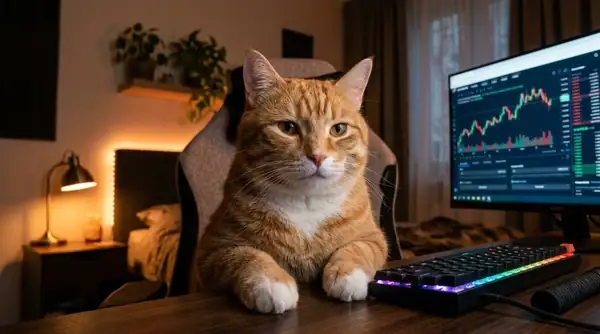

<picture>
  <source media="(prefers-color-scheme: dark)" srcset="assets/board-dark.svg">
  
</picture>

### Hi, I'm Bo

I'm a developer in Vietnam. I've spent most of my career on securities trading platforms, and
these days I mostly work on open-source tools for apps that show a lot of live data.

I build with [Claude Code](https://claude.com/claude-code) every day. Thank you, .

My projects trade on their own little exchange:

<!-- board:start -->
```diff
@@ BO EXCHANGE · SESSION 2026-10-31 · OPEN 24/7 @@
  CODE     STARS   +7D       %  DOWNLOADS/WK   VER      LISTING
+ BO-INDEX    41    +9  +28.1%         12.3k            all listings
+ TCV         31    +6  +24.0%         10.4k   1.54.4   TradeCanvas · trading charts
+ BOG          9    +2  +28.6%          1.9k   3.1.0    bo-grid · price-board grid
! DSA          0     0    0.0%            25   0.2.5    densa · live-data toolkit, Rust
! FSP          0     0    0.0%             -   dev      Fansipan · desktop terminal
+ SVT          1    +1     NEW             -   alpha    Sveltier · UI kit for AI agents
! BCN          0     0    0.0%             -   dev      beacon-parser · analytics tag QA
- BUG      9999+    -1   -0.0%             -   main     bugs · one fewer every day
```

<sub>Refreshed every morning, Vietnam time. Not investment advice.</sub>

<p align="center"></p>
<!-- board:end -->

You can find me at [bonv.dev](https://bonv.dev). If any of this is useful to you, a star moves
the board, and [sponsoring](https://github.com/sponsors/bonguynvan) keeps the exchange open.
